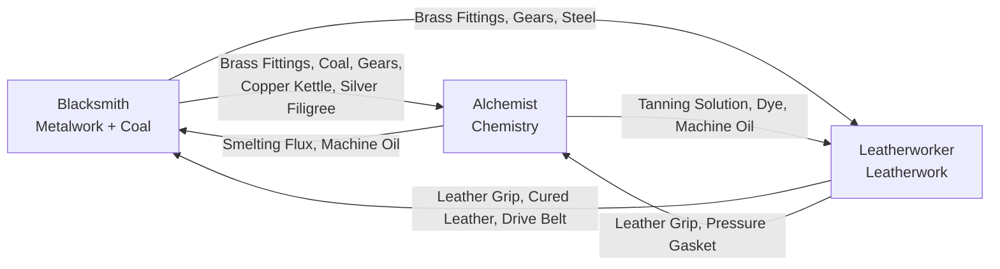

# Guildie — The Profession Web

**Status:** Proposal v0.1 for Marz's review (2026-10-27) · **Companion to:** [GDD.md](GDD.md) §5, [systems.md](systems.md) §5.1

This document sets **how professions need each other**, **how a profession goes from skill 1 to 100**, and **how a new profession joins later**. It guides every recipe we add. Once decisions are confirmed, they move to the GDD Decision Log and the ladder becomes `/content` data.

> **[tune]** marks numbers for the economy simulator and playtests. Recipe and item **names** in the ladder are working names.

---

## Contents

1. [Why a web](#1-why-a-web)
2. [Material families](#2-material-families)
3. [The web rules](#3-the-web-rules)
4. [How engagement happens](#4-how-engagement-happens)
5. [Skill 1–100](#5-skill-1100)
6. [The ladder: all three guilds to 100](#6-the-ladder-all-three-guilds-to-100)
7. [Adding a profession](#7-adding-a-profession)
8. [M2 release plan](#8-m2-release-plan)
9. [Decisions for Marz](#9-decisions-for-marz)

---

## 1. Why a web

Pillar 5 says **you need other crafters**. Pillar 3 says the market works **with 5 players or 5,000**. These pull against each other:

- Too little dependency, and professions are separate single-player games that happen to share an auction house.
- Too much, and a player with no Alchemist friends is stuck, and every new profession makes the old ones harder to play.

The answer is a **web with rules**: dependency grows with rank, every import is a **cost, never a wall** (NPC Guild Suppliers always sell at 1.5 × value), and each profession owns something everyone else wants.

---

## 2. Material families

Each founding guild owns one **family** of components. Every other guild uses that family more as it ranks up. It's the steam-age story told through crafting: metal, chemistry and leather are what every machine is made of.

| Family | Owner | What it is | Members (rank) |
|---|---|---|---|
| **Metalwork** | Blacksmith | Structure and mechanisms | Brass Fittings (A), Iron Ingot (J), Gears (E), Steel Bar (M), plus **Coal**, a raw export (E) |
| **Chemistry** | Alchemist | Reagents, oils and fuels | Smelting Flux (A), Tanning Solution (A), Dye Set (J), Machine Oil (E), Volatile Spirit (M) |
| **Leatherwork** | Leatherworker | Grips, belts and seals | Leather Grip (A), Cured Leather (J), Drive Belt (E), Pressure Gasket (M) |

A = Apprentice, J = Journeyman, E = Expert, M = Master.

**Why families matter for the future:** a new profession doesn't need a custom link to every existing one. It **consumes families** (most will need metal, chemistry or leather) and **adds one new family** that later professions can use. The web grows by layers, not by tangles.

---

## 3. The web rules

Every profession, now and future, follows these rules. Rules **W1–W6** can be checked by `tools/validate_content.py`, so a content change that breaks the web fails CI.

| # | Rule | Why |
|---|---|---|
| **W1** | **Apprentice recipes import nothing.** | A new player is never blocked (GDD 5.5) |
| **W2** | **Imports grow with rank:** about half of Journeyman recipes import from one guild, about three quarters of Expert recipes do, and Master prestige goods need **both** other guilds. | Dependency is a late-game feature, so players learn their own craft first |
| **W3** | **Every rank has at least one recipe with no imports.** | Anyone can always skill up alone: slower or costlier, never stuck (Pillar 3) |
| **W4** | **Supply before demand:** an import must be craftable by its owner at the same rank or lower. | When you first need Machine Oil, Alchemists can already make it |
| **W5** | **Imports are a small share:** 1 imported unit next to 2–3 of your own, and at most about 35% of a recipe's input value [tune]. | The importer pays a fair share; the exporter isn't a bottleneck |
| **W6** | **Every family is used by at least 2 other guilds, and no guild supplies more than half of all import slots.** | Everyone gets customers; no single guild holds everyone hostage |
| **W7** | **Every export has an NPC floor:** Guild Workshops buy a little of every component, and Guild Suppliers sell everything at 1.5 × value. | Works with 5 players (Pillar 3); components are never a dead end |

---

## 4. How engagement happens

Recipes alone create *some* trade. These four mechanisms make the web felt every session:

1. **Skilling goes through the market.** From Journeyman on, the cheapest XP route in each rank includes an import recipe. Leveling creates demand for other guilds' components, just as it does on WoW's auction house.
2. **Workshop upgrades need other families** (M2, systems.md 7.1). The Forge needs Drive Belts and Machine Oil; the Herb Garden needs Brass Fittings and Gears; the Lodge needs Steel and Tanning Solution. That's steady demand *between players*, plus a gold sink.
3. **Coal is the steam age's running cost.** Steam machines (Expert+) burn Coal, which only the Mine produces. That's a raw export with demand that never stops (GDD 7).
4. **Crafting orders cross-pollinate** (M2). An NPC order for your goods sometimes pays in *another* guild's rare raw (e.g. a Leatherworker order paying Starbloom), which seeds the market and gives you something to trade.

---

## 5. Skill 1–100

### Ranks (GDD 3)

| Rank | Skill | Feel | Unlocks [tune] |
|---|---|---|---|
| Apprentice | 1–25 | Hand tools, short crafts | 4 recipes, station raws 1–2 |
| Journeyman | 26–50 | Imports begin | 4 recipes, **3rd craft slot**, first workshop upgrades |
| Expert | 51–75 | Steam machines, longer crafts | 4 recipes, raw 3 (unlocks at skill 40), steam upgrades (burn Coal) |
| Master | 76–100 | Prestige goods, planning | 4 recipes, raw 4 (unlocks at skill 65), second profession at 80 |

### Where skill comes from (#30)

- **Crafting XP** (most of it): each unit crafted gives `recipe XP × colour factor`.
  - Colour factors: **orange 100%, yellow 60%, green 20%, grey 0%**.
  - Recipe XP by rank: **A 10, J 20, E 40, M 80** [tune].
  - Filling the bar gives +1 skill.
- **Discovery:** +1 skill the first time you craft each recipe. That's 16 per profession, so discovery alone can't carry you far.

### Colours

A recipe unlocked at skill **S** is **orange until S+5, yellow until S+12, green until S+20, then grey** [tune].

With unlocks spaced about 6 apart (roughly S = 1, 6, 12, 18 in each rank), there's always an orange or yellow recipe to work on. That keeps WoW's routing puzzle: what's the cheapest recipe that still gives XP?

### XP needed

Going from level L to L+1 needs **20 × (1 + L/20)² XP** [tune]. That works out to:

| Rank | XP for the rank | Average XP per craft | About how many crafts |
|---|---|---|---|
| Apprentice | ~1,400 | ~8 | ~180 short crafts |
| Journeyman | ~4,300 | ~16 | ~270 |
| Expert | ~8,700 | ~32 | ~270 longer crafts |
| Master | ~13,900 | ~64 | ~220 long crafts |

That's about 940 crafts to master a profession: many short crafts early, fewer and longer ones late, matching the GDD's pacing targets (Apprentice in 1–2 days; Master in 3–4 weeks at the final pace).

Raw materials are the real brake: each station makes 30 of its common raw per hour, capped. So the economy simulator, not this table, sets the final numbers. It reports time-to-rank per guild and play style.

---

## 6. The ladder: all three guilds to 100

Four recipes per rank, 16 per profession, 48 in total (12 exist today).

- **Bold inputs** are imports.
- **Role** is one of:
  - **Staple:** a finished good with steady NPC demand.
  - **Export:** a family component sold to other guilds.
  - **Prestige:** a Master finished good.
  - **Part:** made for your own later recipes.
- Rows marked * already exist (Iron Ingot moves from Apprentice to Journeyman to satisfy W1).

Station raws: **Mine:** Copper Ore (1), Iron Ore (15), Coal (40), Silver Ore (65) · **Herb Garden:** Sunleaf (1), Ember Moss (15), Frostcap (40), Starbloom (65) · **Trapper's Lodge:** Raw Hide (1), Thick Hide (15), Eelskin (40), Fine Fur (65).

### Blacksmith (Metalwork)

| Skill | Recipe | Inputs | Role |
|---|---|---|---|
| 1 | Brass Fittings* | 2 Copper Ore | Export |
| 6 | Copper Lantern* | 3 Copper Ore | Staple |
| 12 | Copper Kettle | 3 Copper Ore + 1 Brass Fittings | Staple (and an Alchemist container) |
| 18 | Pig Iron | 2 Iron Ore | Part |
| 26 | Iron Ingot* | 2 Iron Ore + **1 Smelting Flux** | Export / Part |
| 32 | Iron Sword* | 2 Iron Ingot + **1 Leather Grip** | Staple |
| 38 | Horseshoes | 2 Pig Iron | Staple (no import, W3) |
| 44 | Iron Lockbox | 1 Iron Ingot + 2 Brass Fittings | Staple |
| 51 | Gears | 1 Iron Ingot + 1 Brass Fittings + 1 Coal | Export |
| 57 | Steam Valve | 2 Brass Fittings + 1 Gears + **1 Cured Leather** | Staple |
| 63 | Tournament Blade | 2 Iron Ingot + 1 Gears + **1 Machine Oil** | Staple |
| 69 | Pressure Gauge | 2 Gears + 1 Brass Fittings | Staple (no import, W3) |
| 76 | Steel Bar | 2 Iron Ingot + 2 Coal + **1 Smelting Flux** | Export |
| 82 | Silver Filigree | 2 Silver Ore + 1 Brass Fittings | Export (no import, W3) |
| 88 | Clockwork Mechanism | 2 Gears + 1 Steel Bar + **1 Drive Belt** | Prestige |
| 94 | Steam Hammer | 2 Steel Bar + 1 Gears + **1 Drive Belt** + **1 Machine Oil** | Prestige (needs both guilds) |

### Alchemist (Chemistry)

| Skill | Recipe | Inputs | Role |
|---|---|---|---|
| 1 | Healing Draught* | 2 Sunleaf | Staple |
| 6 | Lamp Oil | 3 Sunleaf | Staple |
| 15 | Smelting Flux* | 2 Ember Moss (unlocks at 15) | Export |
| 18 | Tanning Solution* | 1 Sunleaf + 1 Ember Moss | Export |
| 26 | Steam Tonic* | 2 Ember Moss + **1 Brass Fittings** | Staple |
| 32 | Strong Healing Draught | 2 Healing Draught + 1 Ember Moss | Staple (no import, W3) |
| 38 | Dye Set | 2 Sunleaf + 1 Ember Moss | Export |
| 44 | Blasting Powder | 2 Ember Moss + **1 Coal** | Staple |
| 51 | Machine Oil | 2 Frostcap + 1 Ember Moss + **1 Coal** | Export |
| 57 | Frost Draught | 2 Frostcap + 1 Sunleaf | Staple (no import, W3) |
| 63 | Preserving Brine | 1 Frostcap + 1 Tanning Solution + **1 Copper Kettle** | Staple |
| 69 | Etching Acid | 2 Frostcap + 1 Smelting Flux + **1 Leather Grip** (stopper and gloves) | Staple |
| 76 | Volatile Spirit | 2 Starbloom + 1 Ember Moss + **1 Coal** | Export (fuel) |
| 82 | Philosopher's Salt | 2 Starbloom + 1 Frostcap + 1 Smelting Flux | Part (no import, W3) |
| 88 | Elixir of Vigor | 1 Philosopher's Salt + 1 Strong Healing Draught + **1 Silver Filigree** | Prestige |
| 94 | Aether Tonic | 2 Starbloom + 1 Volatile Spirit + **1 Gears** + **1 Pressure Gasket** | Prestige (needs both guilds) |

### Leatherworker (Leatherwork)

| Skill | Recipe | Inputs | Role |
|---|---|---|---|
| 1 | Leather Grip* | 2 Raw Hide | Export |
| 6 | Hide Satchel* | 3 Raw Hide | Staple |
| 12 | Work Gloves | 2 Raw Hide + 1 Leather Grip | Staple |
| 18 | Hide Cord | 2 Thick Hide | Part |
| 26 | Cured Leather* | 2 Thick Hide + **1 Tanning Solution** | Export / Part |
| 32 | Rugged Jerkin* | 2 Cured Leather + **1 Brass Fittings** | Staple |
| 38 | Trail Boots | 2 Thick Hide + 1 Hide Cord | Staple (no import, W3) |
| 44 | Dyed Satchel | 1 Hide Satchel + 1 Hide Cord + **1 Dye Set** | Staple |
| 51 | Drive Belt | 2 Cured Leather + **1 Brass Fittings** | Export |
| 57 | Eelskin Coat | 3 Eelskin + **1 Tanning Solution** | Staple |
| 63 | Explorer's Pack | 1 Cured Leather + 1 Hide Satchel + **1 Machine Oil** (waterproofing) | Staple |
| 69 | Saddle | 2 Cured Leather + 2 Hide Cord | Staple (no import, W3) |
| 76 | Pressure Gasket | 2 Eelskin + **1 Tanning Solution** + **1 Machine Oil** | Export |
| 82 | Fur-lined Cloak | 2 Fine Fur + 1 Cured Leather | Staple (no import, W3) |
| 88 | Aviator's Harness | 2 Cured Leather + 1 Drive Belt + **1 Gears** | Prestige |
| 94 | Diving Suit | 3 Eelskin + 1 Pressure Gasket + **1 Brass Fittings** + **1 Steel Bar** | Prestige (needs both guilds) |

### Checking the ladder against the rules

| Guild | Imports by rank (A/J/E/M) | Self-sufficient each rank (W3) | Its exports are used by |
|---|---|---|---|
| Blacksmith | 0 / 2 / 2 / 3 | ✓ Horseshoes, Pressure Gauge, Silver Filigree | Alchemist (Brass, Coal, Kettle, Gears, Filigree), Leatherworker (Brass, Gears, Steel) |
| Alchemist | 0 / 2 / 3 / 3 | ✓ Strong Draught, Frost Draught, Philosopher's Salt | Blacksmith (Flux, Oil), Leatherworker (Tanning, Dye, Oil) |
| Leatherworker | 0 / 3 / 3 / 3 | ✓ Trail Boots, Saddle, Fur-lined Cloak | Blacksmith (Grip, Cured Leather, Drive Belt), Alchemist (Grip, Gasket) |

**W4 (supply before demand) holds for every import:** e.g. Smelting Flux (Alchemist 15) is first needed at Blacksmith 26, Machine Oil (Alchemist 51) at Blacksmith 63 and Leatherworker 63, and Drive Belt (Leatherworker 51) at Blacksmith 88. The validator will check this automatically.

**Raw unlocks:** no recipe uses a raw before its station unlocks it (e.g. the Alchemist's first two recipes use only Sunleaf; Smelting Flux arrives at 15 with Ember Moss). Today every raw is open from skill 1, so in 0.5.0 existing players get skill for the crafts they've already made, and nobody loses access.

**Notes:**
- **Brass Fittings is the busiest export,** and that's on purpose. It's the steam age's "nails and bolts", made at skill 1 by every Blacksmith and always cheap. W6 keeps any *one* item from dominating as professions are added.
- **Raws are exports too:** Coal from the Mine feeds Alchemists (Machine Oil, Blasting Powder, Volatile Spirit) and everyone's steam machines.

---

## 7. Adding a profession

### The join checklist

A new profession must:
1. **Own a station** with 4 raws (unlocking at 1 / 15 / 40 / 65), and have one signature *decision* (P1).
2. **Consume at least 2 existing families** from Journeyman on.
3. **Add one new family** (2–4 components) that at least 2 existing guilds pick up in later content.
4. **Pass W1–W7** in the validator, including after its components are added to existing guilds' recipes.
5. **Have NPC coverage:** Guild Workshops demand for its components, and persona demand for its staples.
6. **Have room in the player base:** add a profession only when the active player count can support it. Rough rule: at least 3 active players per profession [tune]. Below that, NPCs carry the market and the new guild feels empty.

### Candidates and where they'd fit

| Candidate | Station | Consumes | New family it adds | Who picks it up |
|---|---|---|---|---|
| **Tinker / Engineer** | Scrapyard | Metalwork, Chemistry, Leatherwork (all three) | **Machinery:** steam engines, pumps, automatons | Every guild's steam workshop upgrades. The natural steam-age capstone |
| **Tailor** | Flax & sheep farm | Chemistry (dye), Leatherwork (trim), Metalwork (needles, buttons) | **Textiles:** cloth, thread, canvas | Leatherworker (linings), Alchemist (filters), Engineer (canvas) |
| **Carpenter** | Timber yard | Metalwork (nails, fittings), Chemistry (varnish) | **Woodwork:** planks, barrels, crates | Alchemist (barrels), Blacksmith (handles), Leatherworker (frames) |
| **Jeweler** | Quarry | Metalwork (silver, filigree), Chemistry (etching acid) | **Optics & gems:** lenses, settings | Engineer (lenses), Alchemist (crystal vials) |
| **Cook** | Farm | Chemistry (brine, spices), Metalwork (kettles) | **Provisions:** rations, preserves | Adventurer NPC demand; Guild Week tournaments |
| **Arcanist** | Observatory | Finished goods from everyone | **Enchantments** (a sink: consumes finished goods to improve them) | Everyone's prestige goods |

**Recommendation:** add the **Tinker** first, after M2. It completes the steam-age story (industrialization *is* the progression), and its Machinery family gives every existing guild a reason to trade more. Workshop upgrades in M2 can already be designed with Machinery slots in mind.

### Second profession (skill 80)

With families, a second profession lets a Master supply some of their own imports. That's the earned reward, and it's why the second profession unlocks late: it lowers your dependency only after you've lived inside the web.

---

## 8. M2 release plan

M2's exit question: **"Do I want to come back tomorrow?"**

| Release | Theme | Contents |
|---|---|---|
| **0.5.0 Journeyman** | Skill becomes real | Skill, XP, colours, ranks and discovery (#30). Ladder to skill 50 (new recipes, Iron Ingot moves to Journeyman). Raw 2 unlocks at skill 15. 3rd craft slot at Journeyman. Validator enforces W1–W7. Simulator reports time-to-rank. "While you were away" return screen |
| **0.6.0 Expert** | The steam age arrives | Ladder to 75. Raw 3 (Coal, Frostcap, Eelskin). **Workshop upgrades v1**, rank-capped, costing gold plus other families' components. Coal as a running cost for steam upgrades. Guild Week demand cycle |
| **0.7.0 Master** | Prestige | Ladder to 100. Raw 4. **Crafting orders** (NPC, paying in cross-guild rares). Prestige goods. Quality tiers and procs. Rebalance with the simulator |
| **After 0.7.0** | — | Focus prototype (active play). Second profession at 80. Tinker profession (M3 or later) |

Each release ends with a playtest. Slowing the pace (`pace.time_multiplier`) waits until the gold sinks in 0.6.0 exist (GDD Open Question 5).

---

## 9. Decisions for Marz

1. **Material families:** adopt the three families as the backbone of the web, with each new profession adding one?
2. **The web rules W1–W7:** adopt them, enforced by the content validator?
3. **The ladder:** 16 recipes per profession, 4 per rank, with the drafts above as the starting point (names and inputs open to change)?
4. **Release plan:** three M2 releases (Journeyman → Expert → Master), or one big M2?
5. **Workshop upgrades need other guilds' components:** yes (recommended, the strongest everyday engagement), or gold only?
6. **First new profession after M2:** the Tinker (recommended), the Tailor, or not yet?
