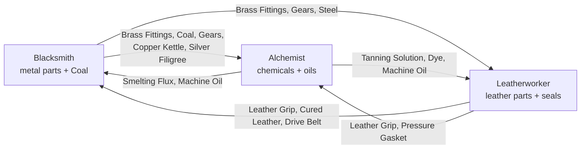

# Guildie — Professions, Progression & the M2 Fun Loop

**Status:** Decided with Marz (2026-10-28) · **Companion to:** [GDD.md](GDD.md) §5 and §2.1, [systems.md](systems.md) §5.1

This document sets:
- **what makes M2 fun:** the order board, the market ticker, and choosing recipes.
- **how a profession goes from skill 1 to 100**, and how XP works.
- **how the three guilds need each other**, and the rules that keep that healthy.
- **the full recipe ladder**, and the order M2 gets built in.

Every recipe and feature in M2 follows it. The decisions are recorded in the GDD Decision Log.

> **[tune]** marks numbers for the economy simulator and playtests. Recipe and item **names** are working names.

---

## Contents

1. [The fun loop](#1-the-fun-loop)
2. [The order board (Workshop)](#2-the-order-board-workshop)
3. [The market ticker](#3-the-market-ticker)
4. [Learning recipes](#4-learning-recipes)
5. [Skill 1–100 and XP](#5-skill-1100-and-xp)
6. [The ladder: all three guilds to 100](#6-the-ladder-all-three-guilds-to-100)
7. [How the guilds need each other](#7-how-the-guilds-need-each-other)
8. [Workshop upgrades: the rank-up moments](#8-workshop-upgrades-the-rank-up-moments)
9. [M2 build order](#9-m2-build-order)
10. [Decided, and on hold](#10-decided-and-on-hold)

---

## 1. The fun loop

Playtest 0.3.0 showed the game was **a working machine with no tension**: everything was done in 20 minutes, the best recipe was obvious, and nothing surprising happened. M2 fixes that by giving the player **decisions on three timescales**. Good management games layer them this way; Melvor Idle always has something to do *now*, a goal for *this session*, and a plan for *this week*.

| Timescale | The player decides | Feature |
|---|---|---|
| **Now** (seconds) | Sell now or hold? Buy the dip? | The market ticker (§3) |
| **This session** (minutes) | Which orders to take? What to queue? | The order board (§2) |
| **This week and beyond** | Which recipes to learn next? Whose goods do I build around? Which upgrade to save for? | Learning recipes (§4), XP (§5), workshop upgrades (§8) |

**The M2 bets.** Each one is checked in the playtest with the question beside it:

| Bet | Playtest question |
|---|---|
| Customers with wants give every check-in a purpose | "Did you open the game to fill an order?" |
| Readable price moves make trading a skill | "Did you ever sell or buy *because* of the arrows?" |
| Choosing recipes creates anticipation and identity | "What recipe are you saving up for, and why that one?" |
| Workshop upgrades make ranks feel like events | "What did reaching Journeyman feel like?" |

References: **Hay Day** (order board), **Shop Titans** (customers with wants), **Old School RuneScape's Grand Exchange** and **Cookie Clicker's stock market** (price arrows), **WoW** and **Final Fantasy XIV** (learning recipes), **Clash of Clans** (the Town Hall upgrade as a milestone).

---

## 2. The order board (Workshop)

Orders live in the **Workshop**, because they're about *making*. The Market is about *trading*. A check-in becomes: collect, check the board, queue crafts.

**Rules** [tune]
- **3 orders on the board** at a time, from named NPC customers with a little personality: "Lady Ashworth needs lanterns for tonight's ball."
- **Scaled to rank:** each order asks for items you can make, or will soon be able to.
- **Orders can ask for several items, including other guilds' goods** (decided). From Journeyman on, some orders are bundles: "An Iron Sword and a flask of Smelting Flux". Bundle orders pay more, and buying the missing part on the Exchange is part of the puzzle. Apprentice orders only ask for your own goods.
- **Deadlines in hours** (e.g. 4–24 h at final pace, scaled by `pace.time_multiplier`). An expired order just leaves; no penalty beyond a missed reward.
- **Skip** an order to get a new one, with a cooldown, so turning one down is a real choice.
- Filling an order **consumes the items** (a sink) and pays a reward.

**Rewards: things the market can't give you.** Otherwise an order is just a slightly better NPC buyer.
- **Gold** (above market value) and **XP** (a large chunk; the best XP for the time spent).
- **Rare materials**, sometimes another guild's (cross-pollination: a Leatherworker might be paid in Starbloom).
- **Rare recipes** (§4): the only way to get some recipes, which makes them trophies.
- Later, reputation with customer types (Townsfolk, Adventurers, Collectors).

---

## 3. The market ticker

Prices should move in ways a player can **read and get ahead of**. Then knowing something early turns into profit, which answers "is making one good trade fun?"

**What players see**
- Every item shows its **price versus usual**, where "usual" is its reference value: `Iron Sword 168g ▲ +20% vs usual`.
- **Green, up:** above usual, a good time to sell. **Red, down:** below usual, a good time to buy.
- A small sparkline of the last day or week, and **"Hot" tags** on the biggest movers.
- A **news board** explaining *why* prices move: "Tournament on Friday: adventurers want swords."

**What moves prices** (they must have causes; random noise makes the arrows meaningless)
1. **Guild Week:** a weekly rhythm (Monday restock, Friday tournament, Sunday market day) that players learn and plan around (GDD 6.5).
2. **Events** announced in advance on the news board: mine collapse, plague, royal commission (GDD 6.5).
3. **Supply:** players flooding or draining an item (scarcity pricing already exists).
4. **Drift back to usual:** prices pull back toward their reference value over time. That's what makes "buy the dip" work, as in Cookie Clicker and Animal Crossing's turnips.

With a handful of players, the NPC market has to **author** these swings; there won't be enough real trading to create them. The NPC price band (0.6–1.5 × value) still bounds every price.

---

## 4. Learning recipes

**Players choose and buy the recipes they learn.** That creates anticipation ("next I'm saving up for the Tournament Blade"), identity, and the gold sink the economy needs (gold only grows today).

**Rules** (decided: no specialization branches for now; maybe later) [tune]
- **One starter recipe per rank is free:** you learn it when you reach the rank, so progression is never blocked. Today's starter recipes stay known.
- **The rest are bought at the guild trainer** for gold. The price rises by rank (e.g. A 50g, J 200g, E 800g, M 3,000g each [tune]). A recipe can be learned once you reach its skill level.
- **Rare recipes** come only from orders (§2) or rare finds: one or two per rank per guild. They're trophies, and better than trainer recipes (more value, or more XP).
- The trainer shows what each recipe needs, including **which other guild's goods**, so a player can build around their trade partners: a Leatherworker with Blacksmith friends picks the recipes that use Brass Fittings and Gears.

**Keeping the choice meaningful without branches**
- Recipes are expensive enough that you **can't buy them all at once**. The order you learn them is the decision, and it plays out over days.
- XP falls off on easy recipes (§5), so *which* recipe you learn next decides how fast you level.
- Rare recipes from orders mean two players of the same guild end up with different collections.

---

## 5. Skill 1–100 and XP

### Ranks (GDD 3)

| Rank | Skill | Feel | What arrives |
|---|---|---|---|
| Apprentice | 1–25 | Hand tools, short crafts | Raws 1–2 (raw 2 at skill 15) |
| Journeyman | 26–50 | Imports begin | **3rd craft slot**, first workshop upgrade, bundle orders |
| Expert | 51–75 | Steam machines, longer crafts | Raw 3 (skill 40), steam upgrades that burn Coal |
| Master | 76–100 | Prestige goods, planning | Raw 4 (skill 65), prestige upgrade; second profession at 80 (later) |

### Where skill comes from
- **Crafting XP** (most of it): each unit crafted gives `recipe XP × colour factor`.
  - Recipe XP by rank: **A 10, J 20, E 40, M 80** [tune].
  - Filling the bar gives +1 skill.
- **XP falls off as recipes get easy** (WoW's colours): a recipe unlocked at skill **S** is
  - **orange (100%)** until S+5
  - **yellow (60%)** until S+12
  - **green (20%)** until S+20
  - **grey (0%)** after that.

  To keep levelling, you have to learn and craft newer recipes.
- **Trade bonus: +25% XP** on recipes that use another guild's goods [tune]. Building around trade partners is *rewarded*, not just allowed. Playing alone stays possible, just slower (rule W3).
- **First craft of the day: double XP** on your first finished batch each day [tune]. A 30-second check-in always moves the bar (Pillar 4).
- **Orders** pay a large chunk of XP (§2).
- **Discovery:** +1 skill the first time you craft each recipe.

### XP needed
Level L to L+1 needs **20 × (1 + L/20)² XP** [tune]:

| Rank | XP for the rank | Average XP per craft | About how many crafts |
|---|---|---|---|
| Apprentice | ~1,400 | ~8 | ~180 short crafts |
| Journeyman | ~4,300 | ~16 | ~270 |
| Expert | ~8,700 | ~32 | ~270 longer crafts |
| Master | ~13,900 | ~64 | ~220 long crafts |

That's about 940 crafts to master a profession, before order XP and bonuses. Raw materials are the real brake (each station makes 30 of its common raw per hour, capped), so the economy simulator sets the final numbers: it reports time-to-rank per guild and play style.

---

## 6. The ladder: all three guilds to 100

Four trainer recipes per rank, 16 per profession, 48 in total (12 exist today). The first recipe of each rank is the free starter; the rest are learned at the trainer (§4). Rare recipes from orders come on top (one or two per rank per guild, designed in step 2 of the build).

- **Bold inputs** are imports.
- **Role** is one of:
  - **Staple:** a finished good with steady NPC demand.
  - **Export:** part of the guild's export line, sold to the other guilds.
  - **Prestige:** a Master finished good.
  - **Part:** made for your own later recipes.
- Rows marked * already exist (Iron Ingot moves from Apprentice to Journeyman to satisfy W1).

Station raws: **Mine:** Copper Ore (1), Iron Ore (15), Coal (40), Silver Ore (65) · **Herb Garden:** Sunleaf (1), Ember Moss (15), Frostcap (40), Starbloom (65) · **Trapper's Lodge:** Raw Hide (1), Thick Hide (15), Eelskin (40), Fine Fur (65).

### Blacksmith (metal parts and fuel)

| Skill | Recipe | Inputs | Role |
|---|---|---|---|
| 1 | Brass Fittings* | 2 Copper Ore | Export |
| 6 | Copper Lantern* | 3 Copper Ore | Staple |
| 12 | Copper Kettle | 3 Copper Ore + 1 Brass Fittings | Staple (and an Alchemist container) |
| 18 | Pig Iron | 2 Iron Ore | Part |
| 26 | Iron Ingot* | 2 Iron Ore + **1 Smelting Flux** | Export / Part |
| 32 | Iron Sword* | 2 Iron Ingot + **1 Leather Grip** | Staple |
| 38 | Horseshoes | 2 Pig Iron | Staple (no import, W3) |
| 44 | Iron Lockbox | 1 Iron Ingot + 2 Brass Fittings | Staple |
| 51 | Gears | 1 Iron Ingot + 1 Brass Fittings + 1 Coal | Export |
| 57 | Steam Valve | 2 Brass Fittings + 1 Gears + **1 Cured Leather** | Staple |
| 63 | Tournament Blade | 2 Iron Ingot + 1 Gears + **1 Machine Oil** | Staple |
| 69 | Pressure Gauge | 2 Gears + 1 Brass Fittings | Staple (no import, W3) |
| 76 | Steel Bar | 2 Iron Ingot + 2 Coal + **1 Smelting Flux** | Export |
| 82 | Silver Filigree | 2 Silver Ore + 1 Brass Fittings | Export (no import, W3) |
| 88 | Clockwork Mechanism | 2 Gears + 1 Steel Bar + **1 Drive Belt** | Prestige |
| 94 | Steam Hammer | 2 Steel Bar + 1 Gears + **1 Drive Belt** + **1 Machine Oil** | Prestige (needs both guilds) |

### Alchemist (chemicals and oils)

| Skill | Recipe | Inputs | Role |
|---|---|---|---|
| 1 | Healing Draught* | 2 Sunleaf | Staple |
| 6 | Lamp Oil | 3 Sunleaf | Staple |
| 15 | Smelting Flux* | 2 Ember Moss (unlocks at 15) | Export |
| 18 | Tanning Solution* | 1 Sunleaf + 1 Ember Moss | Export |
| 26 | Steam Tonic* | 2 Ember Moss + **1 Brass Fittings** | Staple |
| 32 | Strong Healing Draught | 2 Healing Draught + 1 Ember Moss | Staple (no import, W3) |
| 38 | Dye Set | 2 Sunleaf + 1 Ember Moss | Export |
| 44 | Blasting Powder | 2 Ember Moss + **1 Coal** | Staple |
| 51 | Machine Oil | 2 Frostcap + 1 Ember Moss + **1 Coal** | Export |
| 57 | Frost Draught | 2 Frostcap + 1 Sunleaf | Staple (no import, W3) |
| 63 | Preserving Brine | 1 Frostcap + 1 Tanning Solution + **1 Copper Kettle** | Staple |
| 69 | Etching Acid | 2 Frostcap + 1 Smelting Flux + **1 Leather Grip** (stopper and gloves) | Staple |
| 76 | Volatile Spirit | 2 Starbloom + 1 Ember Moss + **1 Coal** | Export (fuel) |
| 82 | Philosopher's Salt | 2 Starbloom + 1 Frostcap + 1 Smelting Flux | Part (no import, W3) |
| 88 | Elixir of Vigor | 1 Philosopher's Salt + 1 Strong Healing Draught + **1 Silver Filigree** | Prestige |
| 94 | Aether Tonic | 2 Starbloom + 1 Volatile Spirit + **1 Gears** + **1 Pressure Gasket** | Prestige (needs both guilds) |

### Leatherworker (leather parts and seals)

| Skill | Recipe | Inputs | Role |
|---|---|---|---|
| 1 | Leather Grip* | 2 Raw Hide | Export |
| 6 | Hide Satchel* | 3 Raw Hide | Staple |
| 12 | Work Gloves | 2 Raw Hide + 1 Leather Grip | Staple |
| 18 | Hide Cord | 2 Thick Hide | Part |
| 26 | Cured Leather* | 2 Thick Hide + **1 Tanning Solution** | Export / Part |
| 32 | Rugged Jerkin* | 2 Cured Leather + **1 Brass Fittings** | Staple |
| 38 | Trail Boots | 2 Thick Hide + 1 Hide Cord | Staple (no import, W3) |
| 44 | Dyed Satchel | 1 Hide Satchel + 1 Hide Cord + **1 Dye Set** | Staple |
| 51 | Drive Belt | 2 Cured Leather + **1 Brass Fittings** | Export |
| 57 | Eelskin Coat | 3 Eelskin + **1 Tanning Solution** | Staple |
| 63 | Explorer's Pack | 1 Cured Leather + 1 Hide Satchel + **1 Machine Oil** (waterproofing) | Staple |
| 69 | Saddle | 2 Cured Leather + 2 Hide Cord | Staple (no import, W3) |
| 76 | Pressure Gasket | 2 Eelskin + **1 Tanning Solution** + **1 Machine Oil** | Export |
| 82 | Fur-lined Cloak | 2 Fine Fur + 1 Cured Leather | Staple (no import, W3) |
| 88 | Aviator's Harness | 2 Cured Leather + 1 Drive Belt + **1 Gears** | Prestige |
| 94 | Diving Suit | 3 Eelskin + 1 Pressure Gasket + **1 Brass Fittings** + **1 Steel Bar** | Prestige (needs both guilds) |

### Checking the ladder against the rules

| Guild | Imports by rank (A/J/E/M) | Self-sufficient each rank (W3) | Its exports are used by |
|---|---|---|---|
| Blacksmith | 0 / 2 / 2 / 3 | ✓ Horseshoes, Pressure Gauge, Silver Filigree | Alchemist (Brass, Coal, Kettle, Gears, Filigree), Leatherworker (Brass, Gears, Steel) |
| Alchemist | 0 / 2 / 3 / 3 | ✓ Strong Draught, Frost Draught, Philosopher's Salt | Blacksmith (Flux, Oil), Leatherworker (Tanning, Dye, Oil) |
| Leatherworker | 0 / 3 / 3 / 3 | ✓ Trail Boots, Saddle, Fur-lined Cloak | Blacksmith (Grip, Cured Leather, Drive Belt), Alchemist (Grip, Gasket) |

**W4 (supply before demand) holds for every import:** e.g. Smelting Flux (Alchemist 15) is first needed at Blacksmith 26, Machine Oil (Alchemist 51) at Blacksmith 63 and Leatherworker 63, and Drive Belt (Leatherworker 51) at Blacksmith 88. The validator will check this automatically.

**Raw unlocks:** no recipe uses a raw before its station unlocks it (e.g. the Alchemist's first two recipes use only Sunleaf; Smelting Flux arrives at 15 with Ember Moss). Today every raw is open from skill 1, so in 0.5.0 existing players get skill for the crafts they've already made, and nobody loses access.

**Notes:**
- **Brass Fittings is the busiest export,** and that's on purpose. It's the steam age's "nails and bolts", made at skill 1 by every Blacksmith and always cheap. W6 keeps any *one* item from dominating as professions are added.
- **Raws are exports too:** Coal from the Mine feeds Alchemists (Machine Oil, Blasting Powder, Volatile Spirit) and everyone's steam machines.

---

## 7. How the guilds need each other

### Export lines
Each guild has an **export line**: what it makes for the other two. As ranks go up, every guild needs more from the others' lines.

| Guild | Export line | Main exports (rank) |
|---|---|---|
| **Blacksmith** | Metal parts and fuel | Brass Fittings (A), Iron Ingot (J), Gears (E), Steel Bar (M), and **Coal**, a raw export (E) |
| **Alchemist** | Chemicals and oils | Smelting Flux (A), Tanning Solution (A), Dye Set (J), Machine Oil (E), Volatile Spirit (M) |
| **Leatherworker** | Leather parts and seals | Leather Grip (A), Cured Leather (J), Drive Belt (E), Pressure Gasket (M) |

### The web rules
Pillar 5 (you need other crafters) pulls against Pillar 3 (it works with 5 players). The rules keep both true: **dependency grows with rank, but it's a cost, never a wall.** Rules W1–W6 are checked by `tools/validate_content.py`, so content that breaks the web fails CI.

| # | Rule | Why |
|---|---|---|
| **W1** | **Apprentice recipes import nothing.** | A new player is never blocked |
| **W2** | **Imports grow with rank:** about half of Journeyman recipes import from one guild, about three quarters of Expert recipes do, and Master prestige goods need **both** other guilds. | Players learn their own craft first |
| **W3** | **Every rank has at least one recipe with no imports.** | Anyone can skill up alone: slower or costlier, never stuck |
| **W4** | **Supply before demand:** an import must be craftable by its owner at the same rank or lower, and no recipe uses a raw before its station unlocks it. | When you first need Machine Oil, Alchemists can already make it |
| **W5** | **Imports are a small share:** 1 imported unit next to 2–3 of your own, and at most about 35% of a recipe's input value [tune]. | The importer pays a fair share; the exporter isn't a bottleneck |
| **W6** | **Every guild's exports are used by both others, and no guild supplies more than half of all import slots.** | Everyone gets customers; nobody holds everyone hostage |
| **W7** | **Every export has an NPC floor:** Guild Workshops buy a little of every component, and Guild Suppliers sell everything at 1.5 × value. | Works with 5 players; components are never a dead end |

### Where trade shows up in play
1. **Skilling:** from Journeyman on, the best XP path uses imports (trade bonus, §5).
2. **Bundle orders** ask for another guild's goods (§2).
3. **Workshop upgrades** need other guilds' parts (§8).
4. **Coal** is the running cost of steam machines, and only the Mine makes it.

---

## 8. Workshop upgrades: the rank-up moments

Reaching a rank should be **an event**: the Clash of Clans Town Hall feeling. Each rank unlocks a workshop upgrade that **visibly changes** the workshop and what it can do. This is the main thing to look forward to between ranks.

**Rules** [tune]
- Each guild's **workstation** and **gathering station** each have upgrade levels. The **highest level is capped by rank** (systems.md 7.1): Journeyman unlocks level 2, Expert level 3, Master level 4.
- An upgrade costs **gold plus parts from other guilds** (decided: yes). This is the strongest everyday reason to trade, and a large gold sink. It also takes **time to build**: "Your Steam Forge will be ready in 6 h".
- Upgrades unlock **how much and how fast** (systems.md 5.1): more craft slots, faster crafts, bigger station caps, higher station rates. They never unlock *what* you can make; skill and recipes do that.
- **Steam upgrades** (Expert+) **burn Coal** while running: a small, ongoing cost that keeps the Mine's Coal in demand.

**Example path: Blacksmith Forge** [tune]

| Level | Rank | Becomes | Costs (beyond gold) | Gives |
|---|---|---|---|---|
| 1 | Apprentice | Hand forge | — | 2 craft slots |
| 2 | Journeyman | Bellows forge | Leather Grip ×10, Cured Leather ×4 (the bellows) | 3rd craft slot, crafts 10% faster |
| 3 | Expert | **Steam forge** | Drive Belt ×6, Machine Oil ×6, Gears ×10 | 4th slot, 20% faster, burns Coal |
| 4 | Master | Steam hammer works | Pressure Gasket ×4, Volatile Spirit ×4, Steel Bar ×10 | 5th slot, 30% faster |

The Herb Garden (Alchemist) and the Trapper's Lodge (Leatherworker) get matching paths, each needing the other two guilds' parts. Visuals are M4 (Look & Feel); in M2, upgrades are text and numbers with a clear "level up" moment.

---

## 9. M2 build order

**One big M2 release** for players (decided), built in an order that proves the fun first. If step 1 doesn't make the game feel alive in our own testing, we learn that before building 36+ recipes on top of it.

| Step | What | Why first |
|---|---|---|
| **1. Fun core** | Order board (§2), market ticker with Guild Week and news events (§3), the "While you were away" screen, small surprises on collect (rich veins, bonus crafts) | Biggest change to how the game feels; works on today's 12 recipes |
| **2. Progression** | Skill and XP (§5), learning recipes at the trainer, rare recipes from orders (§4) | Gives every craft and gold coin a purpose |
| **3. Content** | The ladder to 100 (§6), raws 3 and 4, the validator's web rules (§7) | The long road, now with reasons to walk it |
| **4. Milestones** | Workshop upgrades (§8), Coal running cost | The rank-up moments |

Then a simulator pass, slowing the pace (`pace.time_multiplier`, now that gold sinks exist), and the M2 playtest. M2's exit question: **"Do I want to come back tomorrow?"**

---

## 10. Decided, and on hold

**Decided (2026-10-28):**
1. **Web rules W1–W7** are adopted and enforced by the validator.
2. **The ladder:** 4 trainer recipes per rank as the base, plus rare recipes from orders.
3. **One big M2**, built in the order above.
4. **Workshop upgrades** are the rank-up milestones and need other guilds' parts.
5. **Orders live in the Workshop** and may ask for several items, including other guilds' goods (from Journeyman).
6. **Market ticker** showing price versus usual, with green and red arrows, driven by learnable causes.
7. **Recipes are chosen and bought** (one free starter per rank); no specialization branches for now.
8. **XP falls off on easy recipes**, with a trade bonus and a first-craft-of-the-day bonus.
9. **"Material families" is dropped as a term:** each guild simply has an export line.

**On hold (maybe later):**
- **Specialization branches** (WoW Dragonflight style: pick Weaponsmith, Armorer or Machinist).
- **New professions.** When the time comes, a new guild must:
  - own a station with 4 raws;
  - use at least 2 existing export lines from Journeyman on;
  - add its own export line that both older guilds pick up;
  - pass W1–W7;
  - have NPC coverage;
  - arrive only once there are enough active players (about 3 per guild [tune]).

  The front-runner is a **Tinker** (machinery, steam engines), the natural steam-age capstone.
- **Second profession** at skill 80.
