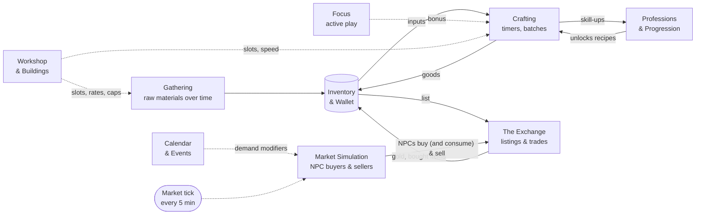

# Guildie — Systems Design

**Version:** 0.4 · **Date:** 2026-10-27 · **Companion to:** [GDD.md](GDD.md)

The GDD describes *what Guildie is*. This document breaks the game into **systems**: self-contained pieces of mechanics, each with one clear job, its own data, and defined connections to the others. Every feature we build should belong to exactly one system (or be explicitly cross-cutting).

> **How to use this doc**
> - Before building a feature, find its system here and follow its rules. If it doesn't fit any system, update this doc first.
> - **[tune]** marks numbers to be set by playtesting.
> - **[Confirmed]** marks defaults Marz confirmed on 2026-10-26 (P1–P6, listed at the end).

---

## Contents

1. [System map](#1-system-map)
2. [Player verbs](#2-player-verbs)
3. [Shared conventions](#3-shared-conventions)
4. [Foundation systems](#4-foundation-systems): Accounts, Time & Timers, Content, Inventory & Wallet, Activity Log
5. [Production systems](#5-production-systems): Professions & Progression, Gathering, Crafting, Focus (active play)
6. [Exchange systems](#6-exchange-systems): The Exchange, Market Simulation, Crafting Orders, Direct Trades
7. [Meta systems](#7-meta-systems): Workshop & Buildings, Calendar & Events, Leaderboards, Guilds
8. [Cross-cutting systems](#8-cross-cutting-systems): Economy Balance, Playtest Feedback, Onboarding
9. [Milestone matrix](#9-milestone-matrix)
10. [Confirmed defaults](#confirmed-defaults)
11. [M1 tuning notes](#m1-tuning-notes)

---

## 1. System map

Systems are grouped in layers (table below). A system may depend on systems in its own layer or layers above it, never below. The diagram shows how value flows between the main systems.

**The core loop in one line:** gather → craft → list → NPCs and players buy (NPCs consume what they buy) → gold → reinvest. Dotted lines are modifiers. Every system also reports into the **Activity Log**.

| Layer | System | One-line job | Status |
|---|---|---|---|
| Foundation | **Accounts** | Who the player is | ✅ M0 |
| | **Time & Timers** | When things happen, including while offline | ✅ M0 (tick), ✅ M1 (timers) |
| | **Content** | What exists (items, recipes, professions) as data | ✅ M1 (launch list + validator) |
| | **Inventory & Wallet** | What the player owns | ✅ M1 (remove, reserve for listings) |
| | **Activity Log** | What happened, for the return screen and history | ✅ M1 (table + writes); return screen M2 |
| Production | **Professions & Progression** | What the player is and how they grow | ✅ M1 (choice); skill M2 (#30) |
| | **Gathering** | Raw materials over time | ✅ M1 |
| | **Crafting** | Turning inputs into goods | ✅ M1 |
| | **Focus** | Optional active play that improves crafts | M2 |
| Exchange | **The Exchange** | Player-facing auction house | ✅ M1; 0.2.2: deposit from the sale, Sell to guild |
| | **Direct Trades** | Player-to-player offers | ✅ 0.3.0 |
| | **Market Simulation** | NPC demand and supply that keeps the market alive | ✅ M1 |
| | **Crafting Orders** | Specific requests with rewards | ✅ 0.5.0 (order board) |
| Meta | **Workshop & Buildings** | Capacity and speed upgrades | M2 |
| | **Calendar & Events** | Weekly rhythm and world events | ✅ 0.5.0 (Guild Week, events, news board); polish M4 |
| | **Leaderboards** | Public rankings | City directory ✅ 0.3.0; full boards M3 |
| | **Guilds** | Social layer | Later |
| Cross-cutting | **Economy Balance** | Faucets, sinks, and monitoring | ✅ M1 (simulator), ongoing |
| | **Onboarding** | The first three minutes | M2 (basic), M4 (polish) |

---

## 2. Player verbs

Everything a player can *do*, and which system owns it. If a new feature adds a verb, add it here.

| Verb | Owner | Session type | Milestone |
|---|---|---|---|
| **Choose** a profession | Professions | Once | M1 |
| **Collect** from a gathering station | Gathering | 30 s | M1 |
| **Decide** a gathering option (vein, plot, expedition length) | Gathering | 30 s | M2 |
| **Craft** (queue a recipe) | Crafting | 30 s | M1 |
| **Collect** finished crafts | Crafting | 30 s | M1 |
| **Tend** active crafts (Focus) | Focus | 30 min | M2 |
| **List** an item for sale | Exchange | 30 s | M1 |
| **Sell to guild** instantly (no listing) | Exchange | 30 s | 0.2.2 |
| **Send feedback** | Playtest Feedback | 30 s | 0.2.2 |
| **Offer / accept / decline / cancel** a direct trade | Direct Trades | 5 min | 0.3.0 |
| **Browse** players and profiles (City) | Leaderboards | 5 min | 0.3.0 |
| **Buy** a listing | Exchange | 5–30 min | M1 |
| **Cancel / relist** | Exchange | 30 s | M1 |
| **Read** prices, history, news | Exchange, Calendar | 5–30 min | M1 (prices), M2 (news) |
| **Fill / turn down** an order | Crafting Orders | 30 s | 0.5.0 |
| **Learn** a recipe | Professions | 5 min | M2 |
| **Upgrade** a building | Workshop | 5 min | M2 |

**Design check:** the 30-second verbs (collect, craft, list) must each be one or two taps. The 30-minute verbs (tend, buy, read) are where depth and skill live.

---

## 3. Shared conventions

These rules apply to every system.

**Time model**
- Nothing runs per second on the server. Every timed thing stores a **start and end timestamp** and is **resolved lazily** when the player acts or loads state (GDD 11.5).
- Offline progress is the same calculation as online progress: `elapsed = now − last_resolved`. There's no separate "offline" code path.
- The **market tick** (every 5 minutes [tune]) is the only scheduled work, and it only touches market and world state, never an individual player's timers.

**Actions**
- Every player action is one server action, in one transaction, that either fully succeeds or changes nothing (GDD 11.2.2).
- Each action validates against current server state, never against what the client thinks.

**Data ownership**
- Each table is owned by one system. Other systems change it only through that system's functions (for example, Crafting calls `inventory_remove()`; it never writes the `inventory` table directly).
- Static definitions live in `/content` JSON. Tuning numbers live in content files, not in code, so balancing never requires a code change.

**Events**
- Any system can write to the Activity Log. The log is append-only and is how the return screen, notifications, and later metrics know what happened.

**Randomness**
- All rolls (procs, rare drops, skill-ups) happen on the server with `random_int`. The client only shows results.

---

## 4. Foundation systems

### 4.1 Accounts

| | |
|---|---|
| **Job** | Identity and sessions |
| **Owns** | `players`, `sessions`, `login_failures` |
| **Status** | ✅ Built in M0 |
| **Rules** | Name + hashed password; session tokens stored as hashes; 30-day idle expiry; 10 failed logins per IP per 15 minutes |
| **Later** | Guest login (backlog), account settings |

### 4.2 Time & Timers

| | |
|---|---|
| **Job** | Decide when things finish and resolve elapsed time, online or offline |
| **Owns** | `game_state` (tick bookkeeping), `tick_log`; the timestamp convention every timed system uses |
| **Inputs** | Server clock; cron |
| **Outputs** | Tick runs for Market Simulation and Calendar; helper functions for "how much time has passed" |
| **Rules** | Tick every 5 minutes [tune] (SiteGround cron), with catch-up on API requests when overdue. A row lock means only one tick runs at a time. |
| **Tuning knobs** | `tick_interval_seconds` = 300 (config.php, must match the cron schedule); `pace.time_multiplier` in `economy.json` scales every duration (1.0 = fast playtest pace) |
| **M1 adds** | Shared timer helpers used by Gathering and Crafting |

### 4.3 Content

| | |
|---|---|
| **Job** | Define everything that exists, as data |
| **Owns** | `/content/*.json`: `items`, `recipes`, `professions`, `economy`, later `buildings`, `personas`, `events` |
| **Rules** | One source of truth, read by both server and client. IDs are lowercase snake_case and never renamed once live (players own items by ID). Every file is validated by a test so a typo can't break the live game. |
| **M1 adds** | Full launch list (GDD 5.5), recipes, three professions, reference values, a content validator |

### 4.4 Inventory & Wallet

| | |
|---|---|
| **Job** | Track what each player owns |
| **Owns** | `inventory` (item, quality, quantity), `players.gold` |
| **Verbs** | None directly; other systems move items through it |
| **Rules** | Only add/remove functions change it, always inside the calling action's transaction. Quantities and gold can never go negative (enforced in code and by unsigned columns). Gold is a whole number. |
| **Tuning knobs** | Starting gold and items (`economy.json`); storage cap [tune, M2] |
| **M1 adds** | `inventory_remove`, items **reserved** while listed on the Exchange (listed items leave the inventory and return if cancelled or expired) |
| **Later** | Storage cap from the Storehouse building (M2) |

### 4.5 Activity Log *(new)*

| | |
|---|---|
| **Job** | Record what happened, so the game can tell the player |
| **Owns** | `activity` table: player (or none for world events), type, small JSON payload, time |
| **Inputs** | Events from every system: craft finished, item sold, listing expired, skill-up, rare drop, order posted, world event |
| **Outputs** | The **"While you were away"** screen (events since last visit), notification badges, later metrics |
| **Rules** | Append-only. Writes happen in the same transaction as the action that caused them. Old rows are pruned by the tick after 30 days [tune]. Price history comes from the Exchange's trade ledger, not from this log. |
| **Why it's foundational** | The return screen is Guildie's retention engine (GDD 8.2), and every system needs a place to report into. Building it in M1 means each new system plugs in from day one. |
| **Milestone** | M1 (table + writes), M2 (return screen UI) |

---

## 5. Production systems

### 5.1 Professions & Progression

> Skill curve, recipe ladder and the cross-profession web rules: [professions.md](professions.md).

| | |
|---|---|
| **Job** | The player's identity and long-term growth |
| **Owns** | `player_professions` (profession, skill, rank, known recipes) |
| **Verbs** | Choose (once), Learn recipe (M2) |
| **Inputs** | Skill-up rolls from Crafting |
| **Outputs** | Which recipes are available; rank, which gates building levels |

**Rules**
- One profession at the start, chosen during onboarding. A second unlocks at skill 80 in the first (GDD 5.7).
- Skill 1–100 in four ranks: Apprentice, Journeyman, Expert, Master.
- Each craft can raise skill based on the recipe's colour (orange 100%, yellow 75%, green 25%, grey 0% [tune]).
- **Progression split [Confirmed]:**
  - **Skill and rank unlock *what* you can make**: recipes, materials, and the right to upgrade buildings to higher levels.
  - **Buildings unlock *how much and how fast***: queue slots, gathering rate, storage, craft speed.
  - Rank is the "Town Hall": it caps building levels, so the two tracks never compete.

**Tuning knobs:** skill-up chances, colour thresholds per recipe, recipe unlock levels, rank boundaries.

**Milestones:** M1 = choice + a fixed starter recipe list. M2 = skill, colours, ranks, learning recipes.

### 5.1b Progression as built *(0.8.0, #30, #49)*

| | |
|---|---|
| **Owns** | `player_professions.skill`, `.xp` (toward the next level), `.bonus_day` (daily double XP used), `.progress_version`; `player_recipes` (known recipes, how each was learned, first craft) |
| **Verbs** | Learn recipe (`trainer`, `learn_recipe`); skill and XP change only on Collect crafts and Fill order |
| **Code** | `server/app/lib/progression.php`; numbers in `content/economy.json` → `progression`, recipe `skill` / `starter` / `rare` in `content/recipes.json`, `unlock_skill` on station outputs |

**Rules (server-side)**
- Ranks: Apprentice 1, Journeyman 26, Expert 51, Master 76. XP for level L to L+1 = 20 × (1 + L/20)².
- XP per craft = recipe XP by its rank (10 / 20 / 40 / 80) × a rare recipe's multiplier × 1.25 if it uses another guild's goods × its colour: orange 100% until 5 above its skill, yellow 60% until 12, green 20% until 20, then grey 0%. These replace the 75% / 25% guesses in 5.1.
- The first batch with XP collected each UTC day pays double. The first craft of each recipe gives +1 skill (discovery).
- Orders pay XP (no fall-off) and sometimes teach a rare recipe of your guild (up to 10 skill above yours).
- Reaching a rank teaches that rank's free starter recipe. Station outputs with `unlock_skill` start gathering once skill reaches it.
- Crafting requires a known recipe (`recipe_not_known`). The trainer refuses rare recipes, recipes above your skill, other guilds' recipes and recipes you know.
- Players from before 0.8.0 are upgraded once (their first request, or the market tick): every non-rare recipe of their guild becomes known and their collected crafts are replayed into skill and XP.

### 5.2 Gathering

| | |
|---|---|
| **Job** | Produce each profession's raw materials over time |
| **Owns** | `stations` (player, station type, last collected time, current option such as chosen vein) |
| **Verbs** | Collect; Decide an option (M2) |
| **Inputs** | Elapsed time; building level (M2) |
| **Outputs** | Raw materials into Inventory |

**Rules**
- Each profession has one station: **Mine** (Blacksmith), **Herb Garden** (Alchemist), **Trapper's Lodge** (Leatherworker).
- Production = `rate × elapsed time`, capped at storage. Resolved when the player collects. Anything past the cap is lost, which is what makes check-ins matter.
- Higher-tier materials (Iron Ore, Ember Moss, Thick Hide) unlock at skill 15 [tune].
- **Each station has one signature *decision* [Confirmed]** (the idle side of the profession's identity):
  - **Mine — Veins:** choose which vein to work. Veins deplete; a "rich vein" appears now and then with a better yield.
  - **Herb Garden — Plots:** choose what each plot grows; different herbs take different times.
  - **Trapper's Lodge — Expeditions:** choose trip length. Short trips are safe and common; long trips have a chance at Thick or rare hides.
- These are *decisions you make at check-in*, not active play. Active play lives in Focus (5.4).

**Balance note:** Gathering is the game's biggest faucet. Every station produces free materials forever, so its rates must be tuned together with Market Simulation's NPC consumption (see 8.1).

**Tuning knobs:** rate per hour, storage cap, unlock levels, vein/plot/expedition tables.

**Milestones:** M1 = one fixed output per station, rate + cap, collect. M2 = signature decisions, rare results.

### 5.3 Crafting

| | |
|---|---|
| **Job** | Turn inputs into goods over time |
| **Owns** | `craft_jobs` (player, recipe, quantity, start, end, status, result) |
| **Verbs** | Craft (queue), Collect |
| **Inputs** | Recipes (Professions), materials (Inventory), slots and speed (Workshop), bonus (Focus) |
| **Outputs** | Items into Inventory; skill-up rolls to Professions; events to the Activity Log |

**Rules**
- Starting a craft **removes the inputs immediately** (no double-spending) and creates a job with an end time.
- A job occupies one **queue slot** until collected. Starting slots: 2 [tune] (so a player can make a component and a finished good at once). More come from rank and buildings.
- Results are rolled **at collection** on the server: quantity (multicraft), refunds (resourcefulness), quality (inspiration), skill-up.
- Craft time scales by recipe tier: seconds to minutes for Apprentice recipes, hours for Master recipes (GDD 3, Target pacing).
- A player can queue a **batch** (up to 10 at once [tune]) in one slot, with total time = per-item time × quantity, so short sessions can set up long idle runs.

**Tuning knobs:** recipe inputs, outputs, time, difficulty; proc chances; starting slots; batch limit.

**Milestones:** M1 = recipes, timers, two slots, batches, collect (Common quality only). M2 = quality tiers, procs, extra slots.

### 5.4 Focus — active play *(new, Confirmed)*

The GDD promises that a 30-minute session rewards active play, but never says what the player's hands are doing. Focus is the proposed answer: **a light "plate-spinning" layer over crafting**, in the spirit of Pythio's high-APM play.

| | |
|---|---|
| **Job** | Make a focused session more rewarding than idling, without punishing idlers |
| **Owns** | Per-job focus state (stability meter, events handled) |
| **Verbs** | Tend |
| **Inputs** | Active craft jobs |
| **Outputs** | Quality and proc bonuses to Crafting |

**Concept [Confirmed]**
- While the player is in the game, active crafts occasionally need attention: the forge cools, a brew starts to bubble over, stitching slips. Each profession skins the same mechanic its own way.
- Tapping the right job at the right time keeps it in the "sweet spot." Managing several jobs at once is the skill.
- Well-tended crafts get a bonus to quality and proc chance (roughly +25–50% value [tune], GDD 5.2).
- Ignoring Focus is fine: the craft finishes normally at base quality. **Idle is never penalised.**
- Anti-cheat: the server issues focus events and checks responses against its own timings, so the bonus can't be faked from the client.

**Open:** this is the biggest unvalidated idea in the design. It should be prototyped as a small experiment in M2 before it's built properly.

**Milestone:** M2 (prototype), then decided.

---

## 6. Exchange systems

### 6.1 The Exchange

| | |
|---|---|
| **Job** | The auction house players use |
| **Owns** | `listings`, `trades` (append-only ledger), `mailbox` |
| **Verbs** | List, Buy, Cancel, Read prices |
| **Inputs** | Items from Inventory; NPC activity from Market Simulation |
| **Outputs** | Gold and items moved between owners; sale events to the Activity Log; price history from `trades` |

**Rules** (GDD 6.1)
- **Buyout only.** A listing has item, quality, quantity, unit price, duration (12/24/48 h [tune]).
- **Listing** moves the items out of inventory and charges a **deposit** (non-refundable, scaled to duration and reference value [tune]: 1% of value per 12 h).
  - **The deposit is never charged up front** (0.2.2): it's recorded on the listing and taken out of the sale money in proportion to how much has sold (`listings.deposit_paid`). On cancel or expiry, the unpaid part is charged only if the seller can afford it; otherwise it's waived. A player with 0 gold can always list.
- **Sell to guild** (0.2.2, `guild_sale.php`): an instant sale with no listing, deposit or cut. The guild consumes the goods (a sink).
  - Price per unit = R × max(floor, base × (1 − drop)^pressure). `pressure` = units this player sold of this item recently (`guild_sales` table); it halves every `recovery_half_life_hours` × pace. Each unit in a batch is priced one step lower.
  - Players see the exact total before confirming; the rule is hidden. A flavour hint appears when the offer is well below normal. If the offer drops between quote and sale, the sale is refused with the new total.
  - Must always pay less than the Traders' quick sale, so listing stays the better choice (enforced by the content validator).
  - **Tuning knobs** (`economy.json` → `guild_sale`): `base_multiplier` 0.5, `drop_per_unit` 0.03, `floor_multiplier` 0.15, `recovery_half_life_hours` 4, `hint_below` 0.6.
- **Buying** locks the listing row, checks the buyer's gold, transfers items to the buyer and gold (minus the **5% cut**) to the seller, and records a trade, all in one transaction. Partial buys of a stack are allowed.
- **Expired or cancelled** listings return items straight to the seller's inventory (M1). A **mailbox** comes when inventory has a cap.
- Every trade shows who the counterparty was: a named player or an NPC persona ("Bought by a sailor").
- Listing limit per player [tune] (GDD 6.7).

**Tuning knobs:** deposit rate, cut, durations, listing limit.

**Milestones:** M1 = full buyout flow, price history. M3 = anti-abuse.

### 6.2 Market Simulation

| | |
|---|---|
| **Job** | Keep the market alive with any number of players (Pillar 3) |
| **Owns** | `market_items` (reference value, band, recent volume, demand state) |
| **Runs** | On every market tick |
| **Inputs** | Content (base values), Exchange (listings, recent trades), Calendar (modifiers) |
| **Outputs** | NPC purchases and NPC listings on the Exchange |

**Rules** (GDD 6.2–6.4)
- **Reference value (R)** per item starts from content and drifts toward recent real trade prices, slowly [tune].
- **Liquidity band:** NPC buyers will always buy at **0.6 × R** or better (floor); NPC sellers keep a small stock at **1.5 × R** (ceiling) [tune]. Players trade inside the band.
- **Each tick, per item:**
  1. Work out NPC **demand** for this tick = base demand × calendar modifier × event modifier [tune].
  2. NPC buyers take the **cheapest listings** whose price is at or below what they're willing to pay (a random price between the floor and a bit above R, depending on the persona), until demand is used up. Bought goods are **consumed**: this is the main sink.
  3. If no one is selling an item, an NPC seller lists a small amount at the ceiling.
  4. Update R and recent volume.
- **Personas** are behaviour profiles, not fake players (GDD 6.3). M1 has five:
  - **Townsfolk:** steady demand for staples (draughts, lanterns, satchels).
  - **Adventurers:** draughts, tonics, swords, jerkins.
  - **Guild Workshops** *(added in M1)*: a little demand for every component, so making components is never a dead end even before other players need them.
  - **Traders:** buy anything players list at 0.8 × R or less within a tick ("quick sale"), resell some near R, consume the rest.
  - **Guild Suppliers:** always offer 5 of every item at the ceiling (1.5 × R).
- **Pricing by scarcity** *(M1)*: for goods NPCs consume, R rises when demand goes unmet and eases down only when all demand was met and a glut is left over. For raw materials, R follows player trade prices: the **median** of the last day's trades, each clamped to the NPC band around the usual value, and only when at least 2 different sellers and 2 different buyers traded (`market.trade_signal_min_traders`); otherwise it drifts back to usual (0.5.1, so two friends wash-trading at 20× move nothing). This stops undercutting alone from dragging prices down while the city still wants more.
- **Demand scales with active players** *(simple version pulled forward from M3)*: NPC demand rates are written for 8 active players and scale with the number active in the last day (minimum 25%), so 3 friends and 30 strangers both get a balanced market.
- Full player-volume scaling per item stays in M3.

**Tuning knobs:** band multipliers, base demand per item, persona price ranges, drift speed, NPC stock size. These are the most important numbers in the game and need an **economy simulator** (see 8.1) before going live.

**0.5.0, the ticker (#45):**
- Every price **drifts back toward its usual value** (`market.reversion_per_hour`), adjusted by Guild Week and events, with a little constant movement (`market.noise_per_hour`), so prices always move and "buy the dip" works.
- Each tick records prices in `market_history` (kept 8 days).
- The Market shows each price **versus usual**, with a green ▲ or red ▼, a sparkline, and **Hot** at ±15% (`market.hot_percent`).

**Milestones:** M1 = R, band, five personas, scarcity pricing, demand scaled by active players. 0.5.0 = ticker, calendar hooks. Later = Collectors, Prospectors, Arsenal personas. M3 = per-item scaling with real-player volume.

### 6.3 Crafting Orders

| | |
|---|---|
| **Job** | Give players direction and guaranteed demand |
| **Owns** | `orders` (item, minimum quality, quantity, deadline, reward, who posted, who filled) |
| **Verbs** | Fulfill |
| **Inputs** | Market Simulation and Calendar post orders |
| **Outputs** | Rewards (gold, rare materials, recipes) to Inventory; events to Activity Log |

**Rules** (decided 2026-10-28, details in [professions.md](professions.md) §2):
- Orders show on an **order board in the Workshop**: 3 at a time, from named NPC customers, scaled to the player's rank.
- From Journeyman on, an order can be a **bundle of several items, including other guilds' goods**.
- Each order has a deadline in hours. Skipping one has a cooldown.
- Fulfilling **removes the items** (consumed: a sink) and pays rewards the market can't give: XP, rare materials (sometimes another guild's), and **rare recipes**, the only way to get some recipes.
- **Rewards are priced from each item's usual value** (0.5.1). The *whole* reward (gold plus any rare material at its usual value) is `reward_multiplier` × that value. The validator keeps this below `market.ceiling_multiplier`, and the **Guild Suppliers never sell below ceiling × usual**, so an order can never be filled at a profit from supplier stock.

Player-posted orders are in the backlog.

**Milestone:** M2.

### 6.4 Direct Trades *(0.3.0)*

| | |
|---|---|
| **Job** | Let two players swap goods and gold directly, without both being online |
| **Owns** | `trade_offers` (sender, recipient, items and gold on each side, note, status, expiry) |
| **Verbs** | Offer, Accept, Decline, Cancel |
| **Inputs** | Items and gold from Inventory & Wallet; players from the City directory |
| **Outputs** | Items and gold moved between players; events to the Activity Log; the City tab badge (`incoming_offers` in state) |

**Rules**
- Sending an offer **holds the sender's side** (removed from inventory and wallet). Declined, cancelled or expired offers return it. Expiry runs in the market tick.
- **Accept** locks the offer row, takes the asked-for side from the recipient (refused if they lack it: nothing changes), and gives each side to the other, in one transaction. A second accept finds the offer closed.
- **Both sides must contain something** (no gifts). **No fee.** Sender and recipient must be different players in a guild.
- Completed trades are recorded on the offer row and in both players' Activity Logs (not in the Exchange `trades` ledger, which is per listing).

**Tuning knobs** (`economy.json` → `trade_offers`): `duration_hours` 24, `max_open_per_player` 5, `max_items_per_side` 5.

**Later:** gifts, a small fee, and anti-abuse checks for alt-account funnelling (M3).

---

## 7. Meta systems

### 7.1 Workshop & Buildings

| | |
|---|---|
| **Job** | The Clash-of-Clans-style base: capacity, speed, and the age-of-invention arc |
| **Owns** | `buildings` (player, type, level, upgrade end time) |
| **Verbs** | Upgrade |
| **Outputs** | Modifiers to Gathering (rate, cap), Crafting (slots, speed), Inventory (storage) |

**Rules**
- Buildings from GDD 8.1: profession workstation, gathering station, Storehouse, Water Wheel (Journeyman+), Mailbox, Guild Board.
- Upgrades cost gold and materials (a sink) and take time.
- **Maximum building level is capped by profession rank** [Confirmed], which keeps the two progression tracks aligned (see 5.1).
- **Machines** (Expert+: water wheels, gear trains, clockwork) automate work and cost **lamp oil and wages** as an ongoing running cost: a sink that scales with how much you automate (replaced coal, 2026-10-28).

**Milestone:** M2 (core upgrades), the 3D harbor on desktop (0.7.0), M4 (final 3D art, machine visuals).

### 7.2 Calendar & Events

| | |
|---|---|
| **Job** | The world's rhythm: why today is different from yesterday |
| **Owns** | `world_events`, the weekly calendar definition |
| **Runs** | On the tick |
| **Outputs** | Demand and supply modifiers to Market Simulation; special orders; news to the Activity Log |

**Rules:** The **Guild Week** cycle (GDD 6.5): Monday restock, Wednesday Regatta announced, Friday Regatta, Sunday market day. **World events** (mine collapse, dock fever, the Libeccio storm, the Doge's commission, a Levant galley) layer on top and are announced in advance on the news board, so information has value.

**0.5.0 (#46):** `content/calendar.json` defines each Guild Week day and the world events.
- Each day or event can multiply an item's **NPC demand** and set where its **price** drifts toward.
- In the market tick, an event is announced on the **news board** about 6 hours ahead (`world_events` table), one at a time, and then runs for about 10–12 hours. Both durations scale with the pace.
- The news board is at the top of the Market.

**Milestone:** 0.5.0 (Guild Week, events, news board), M4 (news board polish).

### 7.3 Leaderboards

| | |
|---|---|
| **Job** | Public goals and friendly rivalry |
| **Owns** | Derived views (no data of its own) |
| **Rules** | Two boards: **total gold** (decided: not net worth) and **rank progress**. Until skill points exist, "Mastery" ranks by crafts made. |
| **0.3.0: City directory** | Every player in a guild in one list with **gold** and **crafts made** columns (tap a heading to sort; gold by default), with guild and last seen. The #1 by gold carries the title "Il Factotum della Città" (`economy.json` → `city.top_title`; decided by the server). A profile shows gold, crafts made, recipes discovered, their active Exchange listings (buyable) and **Propose a trade**. Computed on request (`players.php`). |
| **Milestone** | City directory 0.3.0; full boards with rank progress M3 |

### 7.4 Guilds

Social layer: guild orders needing several professions, a shared guild hall, guild rankings (GDD 8.3). **Later.**

---

## 8. Cross-cutting systems

### 8.1 Economy Balance

Not a feature, but a system with its own tools and rules.

**Faucets** (value enters): NPC purchases, order rewards, gathering, rare drops and procs.
**Sinks** (value leaves): NPC consumption of bought goods, deposits and the 5% cut, recipe purchases, building upgrades, machine running costs (lamp oil and wages), the second profession unlock.

**Rules**
- Every new faucet must ship with a matching sink, or a note on which existing sink absorbs it.
- The core balance equation per item: *gathering output across all players* ≈ *NPC consumption + player use* over a typical week. If output wins, prices fall to the floor and stay there.
- **Economy simulator [Confirmed, built in M1]:** a small script that runs a simulated week with N virtual players following simple strategies, using the real content numbers and market rules. It reports price curves, gold in circulation, and time-to-rank. We tune numbers there before they reach the live game.
- **Live watch metrics:** gold in circulation, median price per item, daily gold in vs out, share of sales to NPCs vs players (GDD 7, 13).

### 8.2 Playtest Feedback *(0.2.2)*

A **Feedback** button in the game header opens a text box (up to 1,000 characters). Each note is saved in the `feedback` table with the player, guild, gold, current screen and build; 10 per player per hour. Marz reads them on a private page (`action=feedback_list&key=…`), whose key lives only in `guildie-private/config.php`; with no key set, the page is off. Setup: [deploy.md](deploy.md#deploying-022-0-gold-fix-sell-to-guild-feedback).

### 8.3 Onboarding

The first three minutes (GDD 9): choose a profession → collect → craft → **guaranteed first sale** → first order → queue a long craft. Uses the other systems; owns only a per-player tutorial step. M2 basic flow, M4 polish.

---

## 9. Milestone matrix

What each system delivers in each milestone.

| System | M1 Market Prototype | M2 Crafting Depth | M3 Real Players | M4 Look & Feel |
|---|---|---|---|---|
| Accounts | — | — | — | Guest login? |
| Time & Timers | Timer helpers | — | — | — |
| Content | Full launch list + validator | Recipes for full skill curve | — | — |
| Inventory & Wallet | Remove, reserve for listings | Storage cap | — | — |
| **Activity Log** | **Table + writes** | Return screen | Metrics | — |
| Professions | Choice, starter recipes | Skill, colours, ranks, learning | — | Second profession? |
| Gathering | Rate + cap + collect | Signature decisions, rares | — | — |
| Crafting | Timers, batches, 2 slots | Quality, procs, more slots | — | — |
| Focus | — | **Prototype** | Build if it works | Polish |
| Exchange | Buyout flow, price history | Mailbox | Anti-abuse, limits | — |
| Market Simulation | R, band, 5 personas, scarcity pricing, active-player scaling | More personas, calendar | Player-volume scaling | — |
| Crafting Orders | — | NPC orders | — | — |
| Workshop | — | Upgrades, rank caps | — | Isometric art |
| Calendar & Events | — | Guild Week | — | World events, news |
| Leaderboards | City directory (0.3.0) | — | Gold + rank | — |
| Economy Balance | **Simulator** | Retune | Live metrics | — |
| Onboarding | — | Basic flow | — | Polish |

**M1 in one sentence:** *Choose a profession, gather, craft, and sell to a living NPC market, with enough numbers in place to answer "is making one good trade fun?"*

---

## Proposed defaults to confirm

These were chosen to unblock the design. Each is marked **[Confirmed]** above. Confirm or change them; once confirmed, they move to the GDD Decision Log.

| # | Question | Proposed default | Where |
|---|---|---|---|
| P1 | Where do signature mechanics live? | **One idle decision per gathering station** (veins, plots, expeditions). Active play is a separate shared system, Focus, skinned per profession. | 5.2, 5.4 |
| P2 | How do the two progression tracks relate? | **Skill/rank unlocks what you can make; buildings unlock how much and how fast; rank caps building level.** | 5.1, 7.1 |
| P3 | What is active play? | **Focus:** tend several active crafts at once (plate-spinning) for quality and proc bonuses. Idle gets base results. Prototype in M2 before committing. | 5.4 |
| P4 | Add an Activity Log system? | **Yes, in M1.** It's the foundation for the return screen and notifications. | 4.5 |
| P5 | Build an economy simulator? | **Yes, in M1,** before the NPC market goes live. | 8.1 |
| P6 | Can players craft in batches? | **Yes,** several of one recipe in a single slot, so short sessions can set up long idle runs. | 5.3 |

---

## M1 tuning notes

What the economy simulator (`tools/econ_sim.php`) showed while building M1, and what changed. Each run: bot players in two play styles (checking in every 2–4 hours, or every 30–60 minutes in the evening), nobody playing overnight, one simulated week.

| Run | Finding | Change |
|---|---|---|
| 1 | No tier-2 goods were ever made: components had no visible demand, so nobody made Brass Fittings or Leather Grips | Added the **Guild Workshops** persona |
| 1 | Sellers undercutting each other dragged prices 20–30% down while demand was unmet | **Scarcity pricing** for consumer goods |
| 2 | A bug: ticks where no NPC shopped counted as "glut" and lowered prices | Glut check only runs when demand was fully met |
| 3 | Fixed NPC demand overwhelmed 6 players: everything hit the 2× price cap | **Demand scales with active players** (reference 8) |
| 1–3 | Alchemists earned 3–5× more than others (draughts sell constantly) | Draught demand lowered; satchel and jerkin demand raised |
| Final | 3 players, one week: Blacksmith 4,950 · Alchemist 7,409 · Leatherworker 5,878 gold. Draughts in mild oversupply (price drifting down); Brass Fittings and Steam Tonic scarce (price up). 3 and 6 players behave alike. | Shipped in 0.2.0 |

**Playtest 1 feedback (2026-10-27, Marz as Blacksmith):** reached 0 gold and couldn't list or buy (#27; safety valve #28); wants visible skill points like WoW, e.g. 100/100 (#30); no way to meet or trade with other players outside the Exchange (#31, #32).

**Known gaps for M2:** gold only grows (players had ~6,000 each after a week, with little to spend it on). M2's sinks (recipes, workshop upgrades, machine running costs) are needed before pacing slows down.
